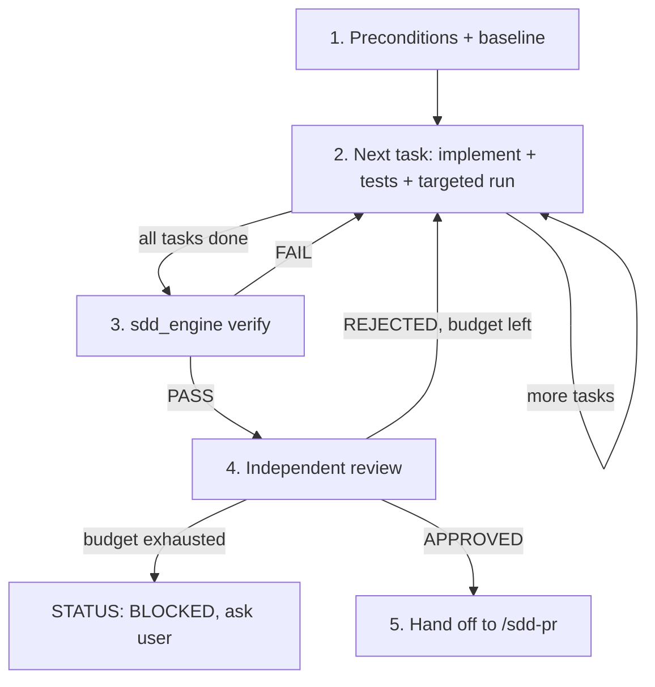

# SDD Loop: Incremental Implementation, Independent Review, Measured Verification

You are the Execution Coordinator. Two roles take part: the **Generator** writes code and tests;
the **Reviewer** audits them. Approval is only valid when it is backed by evidence that a tool
produced (test output, `verification.md`), never by the Generator's own assessment.

## User Input

```text
$ARGUMENTS
```

The module slug. If omitted, use the module with status `Specified` in `python scripts/sdd_engine.py status`.



---

## Step 1: Preconditions & Baseline

1. `python scripts/sdd_engine.py validate --module <slug>` must report 0 errors. If not, stop and run `/sdd-spec`.
2. Every module in `Depends On` should be `Done` (or its contracts merged). Otherwise stop and tell the user.
3. Start from an up-to-date base branch; create the working branch `feature/<slug>` (or the slice branch from `plan.md`).
4. Record the baseline before changing anything:
   ```bash
   python scripts/sdd_engine.py verify --module <slug> --baseline
   ```
   Pre-existing failures are listed in the review log as not caused by this module. They must not
   be "fixed" by deleting or skipping tests.
5. Set the roadmap status to `In Progress`.

## Step 2: Generator, One Task at a Time

Work through `tasks.md` in dependency order, one delivery slice at a time. For each task:

1. Read only the files the task and plan name, plus whatever a targeted search shows you need.
   Follow the conventions in `project-context.md`.
2. Implement the behaviour **and** its tests in the same task. Every test that verifies a criterion
   includes the ID in its name or a comment (e.g. `test_AUTH_AC_02_rejects_empty_email` or `// AUTH-AC-02`).
   Underscores are accepted in identifiers.
3. Run the module's targeted tests (`module_commands` in `.specify/config.json`, or the plan's command).
4. Tick the task only when its tests pass. Never tick tasks in bulk.

Hard rules (the Reviewer and `verify` check these):
- Do not delete, skip, or weaken existing tests or assertions to make the suite pass.
- No focused tests (`.only`, `fit`). New skips need a written justification in the review log.
- No changes outside the files the plan names unless you record why.
- No new third-party dependency that the plan does not list.
- Never invent API shapes or behaviour the spec does not define. If the spec is wrong or silent,
  stop and raise it with the user, then update the spec first.

## Step 3: Measured Verification

```bash
python scripts/sdd_engine.py verify --module <slug>
```

This runs the configured lint, build, and full test commands, checks that every AC/E2E ID is
referenced by a test, that all tasks are ticked, and that no focused tests exist, then writes
`verification.md` with `RESULT: PASS|FAIL` and a code fingerprint. Fix every failure and rerun.
Compare against the baseline: any test that passed in the baseline and fails now is a regression
caused by this module.

## Step 4: Independent Review

The Reviewer must not be the context that wrote the code. If your platform supports sub-agents,
start a fresh one and give it only: `spec.md`, `plan.md`, `constitution.md`, `project-context.md`,
the diff (`git diff <base>...HEAD` plus uncommitted changes), and `verification.md`. Do not give it
the Generator's reasoning. If sub-agents are unavailable, clear your working assumptions and review
the diff from scratch as if someone else wrote it.

The Reviewer:
1. Builds the **AC coverage matrix**: for every AC/E2E ID, where it is implemented and which test
   verifies it, and whether that test actually asserts the "Then" outcome (not just that code ran).
2. Audits five pillars, citing `file:line` evidence for every finding:
   | Pillar | Questions |
   | :--- | :--- |
   | Spec adherence | Does behaviour (status codes, payloads, state) match each AC exactly? Anything built that the spec does not ask for? |
   | Test quality | Do assertions check outcomes? Are failure paths tested? Any skipped, focused, or tautological tests? |
   | Architecture & conventions | Constitution rules, layer boundaries, existing repo patterns, no unexplained new dependencies |
   | Errors & edge cases | Null/empty/boundary input, concurrency, idempotent retries, RFC 7807 errors without leaking internals |
   | Security & performance | AuthZ on every mutating path, tenant isolation, secrets/PII, injection, N+1 queries, unbounded loads |
3. Assigns severity: Critical / Major block approval; Minor / Nit do not.
4. Appends an iteration section to `review-log.md` using `.specify/templates/review-log-template.md`,
   ending with exactly one status line: `STATUS: REJECTED` or `STATUS: APPROVED`.

`APPROVED` is only allowed when there are no open Critical/Major findings **and** the latest
`verification.md` says `RESULT: PASS` for the code being reviewed.

On `REJECTED`, the Generator fixes each finding (Step 2 rules apply), reruns Step 3, and the
Reviewer re-reviews. The iteration budget is `max_review_iterations` in `.specify/config.json`
(default 3). When it is exhausted, append `STATUS: BLOCKED` with the unresolved findings and stop:
ask the user to decide (narrow the spec, accept a risk, or provide guidance). Never self-approve to
escape the loop.

## Step 5: Hand Off

1. Rerun `python scripts/sdd_engine.py verify --module <slug>` if anything changed after the last run (the PR step rejects stale verification).
2. Set the roadmap status to `In Review`.
3. Report to the user: iterations used, findings fixed, test counts from `verification.md`, any
   accepted Minor findings, and any baseline failures that remain.

> "`<slug>` is approved with verification PASS. Continue with `/sdd-pr <slug>`."
