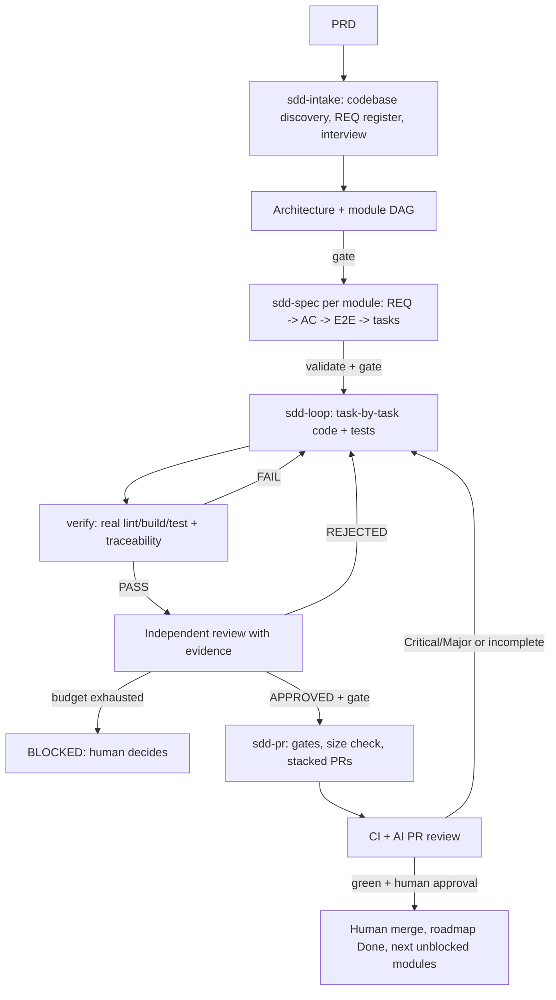

# 🚀 Autonomous Spec-Driven SDLC Toolkit

[](LICENSE)
[](#)
[](#)
[](#)

A **Spec-Driven Development (SDD) AI workflow** that turns a Product Requirements Document (PRD) into
traceable specs, tested code, and reviewable GitHub pull requests.

Agents do the reasoning (requirements, design, code, review). A zero-dependency Python engine
scaffolds the artifacts and **independently checks** the agents' work, so the workflow cannot report
a pass it did not measure. It is built for large and existing codebases: requirement IDs that trace
all the way to tests, a module dependency graph that shows what can run in parallel, size-capped and
stacked PRs, and an AI PR reviewer that handles diffs of any size.

---

## 📦 What's in This Toolkit?

```text
sdlc-workflow-automate/
├── .agents/skills/
│   ├── sdd-intake/SKILL.md        # Codebase discovery, requirements register, interview, roadmap
│   ├── sdd-spec/SKILL.md          # Traceable spec (REQ -> AC -> E2E -> task), plan with delivery slices
│   ├── sdd-loop/SKILL.md          # Task-by-task implementation, independent review, measured verification
│   └── sdd-pr/SKILL.md            # Gated, right-sized (optionally stacked) PRs and review triage
├── .github/
│   ├── scripts/pr_review_agent.py # Gemini PR reviewer: batched, line-anchored, evidence-checked
│   └── workflows/
│       ├── ci-template.yml        # SDD artifact gates + stack-specific build/test template
│       └── pr-review-agent.yml    # Runs the AI reviewer on every PR update
├── .specify/
│   ├── config.json                # Commands, branch names, PR size limit, review budget
│   ├── memory/constitution.md     # Non-negotiable engineering principles (versioned)
│   ├── templates/                 # spec, plan, tasks, checklist, review-log, requirements,
│   │                              # module-decomposition, project-context
│   └── workflows/sdd-full/workflow.yml  # Spec-Kit pipeline with four human gates
└── scripts/sdd_engine.py          # Scaffolding + validation + verification CLI (stdlib only)
```

Generated per project:

```text
.specify/
├── memory/project-context.md              # Discovered layout, conventions, verified commands
├── architecture/
│   ├── requirements.md                    # REQ-NNN register with owner module
│   ├── system-architecture.md             # Decisions + ADRs
│   └── module-decomposition.md            # Modules, keys, dependency DAG, status
└── specs/<module-slug>/
    ├── spec.md  plan.md  tasks.md  checklist.md
    ├── review-log.md                      # Review iterations, AC coverage matrix, STATUS line
    ├── verification-baseline.md           # Test state before the module was built
    ├── verification.md                    # Measured lint/build/test result + code fingerprint
    └── pr-body.md                         # Generated from the artifacts above
```

---

## 🎯 How Accuracy Is Enforced

| Risk in AI-driven delivery | Control |
| :--- | :--- |
| Requirements silently dropped | `requirements.md` gives every PRD statement a `REQ-NNN` ID and one owner module; `validate --all` lists unowned requirements |
| Acceptance criteria never built or tested | IDs flow `REQ -> <KEY>-AC-NN -> <KEY>-TNNN -> test`; `validate` fails on any criterion without a task or a test that names it |
| Agent guesses where the PRD is vague | `[NEEDS CLARIFICATION]` and `TODO(sdd)` markers block validation until a human answers |
| Generated code ignores existing patterns | Intake writes `project-context.md` from the real repo; the plan must follow it |
| Generator approves its own work | Review runs in a separate context, cites `file:line` evidence, and is capped; exhaustion means `STATUS: BLOCKED`, not approval |
| "All tests pass" claimed but not run | `verify` runs the real commands and records exit codes, counts, and logs; the engine never writes a pass it did not observe |
| Code changed after it was verified | A code fingerprint in `verification.md` must match at PR time |
| Suite made green by skipping tests | Focused tests fail validation; new skips are flagged for justification; baseline vs current shows regressions |
| PRs too big to review | Size gate (`max_pr_changed_lines`) and stacked PRs from the plan's delivery slices |
| AI reviewer truncates or hallucinates | Every file reviewed in batches, real line numbers in the prompt, out-of-diff findings dropped, unquotable blocking findings downgraded, verdict computed from severities, errors fail the check |

---

## 🧰 Tools & Technologies

| Category | Tool | Role |
| :--- | :--- | :--- |
| **AI Orchestration** | Antigravity / Claude Code / Copilot agents | Run the `.agents/skills/` slash commands |
| **AI PR Reviewer** | [Google Gemini](https://aistudio.google.com/) | `.github/scripts/pr_review_agent.py` (model set by `GEMINI_MODEL`, default `gemini-2.5-flash`) |
| **Spec Framework** | Spec-Kit structure | `.specify/` templates, constitution, workflow |
| **Engine** | Python 3.10+ (`sdd_engine.py`) | Scaffold, validate, verify, status, PR gates. No third-party packages |
| **Version Control & PRs** | Git + [GitHub CLI](https://cli.github.com/) | Branches, pushes, `gh pr create`, review triage |
| **CI/CD** | GitHub Actions | Artifact gates, build/test, AI review |
| **Error Contracts** | [RFC 7807](https://datatracker.ietf.org/doc/html/rfc7807) | Problem Details error payloads in specs and tests |

### Toolchain auto-detection (override in `.specify/config.json`)

| Ecosystem | Detected by | Lint / Build | Test |
| :--- | :--- | :--- | :--- |
| **.NET** | `*.sln`, `*.slnx`, `*.csproj` | `dotnet build --warnaserror` | `dotnet test --no-build` |
| **Node.js / TypeScript** | `package.json` scripts | `npm run lint`, `npm run build` (if defined) | `npm test` |
| **Go** | `go.mod` | `go vet ./...`, `go build ./...` | `go test ./...` |
| **Rust** | `Cargo.toml` | `cargo clippy --all-targets -- -D warnings` | `cargo test` |
| **Python** | `pyproject.toml`, `setup.cfg`, `pytest.ini`, ... | `ruff check .` (if installed) | `pytest` |

If no test command is configured or detected, `verify` **fails** rather than passing silently. For
monorepos, set `commands` for the full gate and `module_commands.<slug>.test` for fast per-module runs.

---

## ⚡ Quickstart

### Prerequisites
1. **Python 3.10+**, **Git**, and **GitHub CLI** (`gh auth login`).
2. A [Google AI Studio API key](https://aistudio.google.com/) for the AI PR reviewer.

### 1. Add the toolkit to your project

```bash
cp -r /path_to_this_repo/.agents /path_to_this_repo/.github /path_to_this_repo/.specify /path_to_this_repo/scripts .
```

Then edit `.specify/config.json` (base branch, commands, PR size limit) and enable your stack in
`.github/workflows/ci-template.yml`.

### 2. Configure GitHub
1. Add the repository secret `GEMINI_API_KEY` (Settings > Secrets and variables > Actions).
2. In branch protection for `main`: require the `sdd-gates`, `build-and-test`, and `review` checks, and at least one human approval.
3. Optional repository variables: `GEMINI_MODEL`, `GEMINI_FALLBACK_MODELS`, `AI_REVIEW_MAX_BATCHES`, `AI_REVIEW_BATCH_CHARS`, `AI_REVIEW_IGNORE`, `AI_REVIEW_FAIL_ON_PARTIAL`, `AI_REVIEW_OPTIONAL`.

### 3. Run the workflow

#### In an agent chat

```text
/sdd-intake docs/prd.md      # once per project (or per major PRD revision)
/sdd-spec auth-service       # then, per module:
/sdd-loop auth-service
/sdd-pr auth-service
```

#### Engine commands (used by the skills, also useful directly)

```bash
python scripts/sdd_engine.py intake --prd docs/prd.md       # scaffold architecture artifacts
python scripts/sdd_engine.py spec --module auth-service     # scaffold a module spec suite
python scripts/sdd_engine.py validate --all                 # roadmap + every spec
python scripts/sdd_engine.py validate --module auth-service --stage impl
python scripts/sdd_engine.py verify --module auth-service --baseline
python scripts/sdd_engine.py verify --module auth-service   # run real lint/build/test
python scripts/sdd_engine.py status                         # roadmap, readiness, gate state
python scripts/sdd_engine.py pr --module auth-service --dry-run
python scripts/sdd_engine.py run-all --prd docs/prd.md --module auth-service --mock   # smoke test
```

Scaffolding commands never overwrite existing files unless `--force` is passed. `loop` only runs a
labelled simulation (`--mock`); the real loop is the `/sdd-loop` skill.

---

## 🔄 Lifecycle



### Stage 1: Intake (`/sdd-intake`)
Discovers the existing repo (layout, conventions, verified commands) into `project-context.md`;
builds `requirements.md` section by section; interviews the user only on decisions that change the
design; writes the architecture with ADRs; amends the constitution; decomposes into modules with
unique keys, owned requirements, and an acyclic dependency graph.

### Stage 2: Spec (`/sdd-spec`)
Scaffolds from templates, then fills a spec where every owned requirement has observable
acceptance criteria, contracts provided/consumed are explicit, and brownfield impact is listed. The
plan follows existing conventions and splits work into PR-sized delivery slices. `validate` must
report 0 errors before the gate.

### Stage 3: Loop (`/sdd-loop`)
Records a verification baseline, implements one task at a time with tests that name their criteria,
runs `verify`, then hands the diff to a reviewer in a fresh context that builds an AC coverage matrix
and cites evidence for each finding. The iteration budget comes from `.specify/config.json`; running
out produces `STATUS: BLOCKED`.

### Stage 4: PR (`/sdd-pr`)
`pr` refuses to proceed unless the review is approved, verification passed on the current code,
traceability is complete, the diff is within the size limit, and no secret-like files are staged.
Oversized modules ship as stacked PRs. Agents triage CI and AI review feedback but never merge.

### Stage 5: AI PR Review (`pr-review-agent.yml`)
Fetches every changed file through the paginated API, skips generated/lock/binary files (listed in
the review), orders files by risk, and reviews them in batches with exact line numbers. Findings are
posted inline. The check fails on Critical/Major findings or when the review could not complete.
Rules come from the **base branch** constitution, so a PR cannot weaken the rules it is judged by.

---

## 🗺️ Module Roadmap & Implementation Status

Updated by `/sdd-pr` from `verification.md` and `review-log.md`. Live state: `python scripts/sdd_engine.py status`.

| Module Slug | Key | Scope | Branch | PR | Review | Verification |
| :--- | :--- | :--- | :--- | :--- | :--- | :--- |
| *`auth-service`* *(example)* | `AUTH` | *Authentication & sessions* | `feature/auth-service` | Pending | `APPROVED` | PASS (42 passed, 0 failed) |

### 📚 Governance Documents
- **AI Agent Guidance**: [`AGENTS.md`](AGENTS.md)
- **Constitution**: [`.specify/memory/constitution.md`](.specify/memory/constitution.md)
- **Pipeline**: [`.specify/workflows/sdd-full/workflow.yml`](.specify/workflows/sdd-full/workflow.yml)
- **Templates**: [`.specify/templates/`](.specify/templates/)
- **Configuration**: [`.specify/config.json`](.specify/config.json)

---

## 🤖 AI-Driven Development & Contributing

Autonomous coding agents (Antigravity, Cursor, Claude Code, GitHub Copilot) operating in this repository must consult [AGENTS.md](AGENTS.md) for strict SDD workflow invariants, Python 3 stdlib requirements (`scripts/sdd_engine.py`), and verification measurement gates.

---

## 📄 License

MIT. See [LICENSE](LICENSE).
